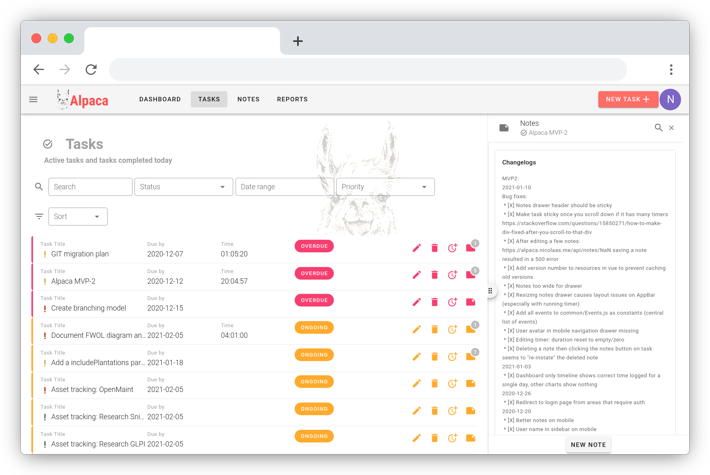
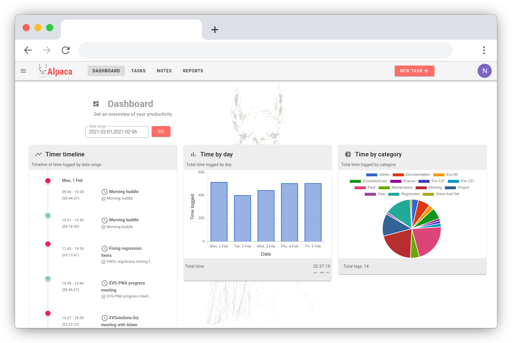

# Alpaca (Lamoid)

Get things done, like alpacas do. Lamoid is a simple task list, time tracker and
productivity tool: plan your day with tasks, track time against them, keep notes
and review reports.




## Stack

- Backend: Laravel 8 (PHP 8.0+), Laravel Passport (API auth), Horizon/Redis (queues)
- Frontend: Vue 2, Vuetify 2, Vuex, Vue Router, built with Laravel Mix
- Database: MariaDB/MySQL (tests use in-memory SQLite)
- Dev environment: Docker Compose (nginx, php-fpm, node, MariaDB, Redis, MailHog)

## Development

### Requirements

- Docker and Docker Compose
- An external Docker network named `reverse-proxy`: `docker network create reverse-proxy`

### Setup

```sh
cp .env.example .env
# edit .env: set DB_PASSWORD, FILE_DOWNLOAD_SECRET; optionally ADMIN_EMAIL/ADMIN_PASSWORD for a first super user
docker-compose up -d
./docker-run.sh -c install                 # composer install
./docker-run.sh -a key:generate            # sets APP_KEY
./docker-run.sh -a migrate
./docker-run.sh -a passport:install
```

The `lamoid.node` container runs `npm install && npm run watch`, so frontend
assets rebuild automatically. The site is served by nginx on `VIRTUAL_HOST`
(default `alpaca.local`, add it to `/etc/hosts`). MailHog is available on port 8025.

Helper script: `./docker-run.sh -a <artisan args>`, `-c <composer args>`, `-n <npm args>`.

### Without Docker

Requires PHP 8.0 (with `pcntl`, `sodium`, `gd`, `zip`, `pdo_mysql`), Composer,
Node 12–16 (newer Node needs `NODE_OPTIONS=--openssl-legacy-provider`), MySQL and Redis.

```sh
composer install
npm ci && npm run development
php artisan migrate && php artisan passport:install
php artisan serve
```

### Tests and linting

```sh
php artisan test        # or: vendor/bin/phpunit
npx eslint resources/js
```

### Optional: Google Drive backups

Place your own OAuth client file at `public/secret/credentials.json`
(never commit it; it is git-ignored). Obtain it from the Google Cloud console.

## License

Released under the MIT License (see `LICENSE`).
